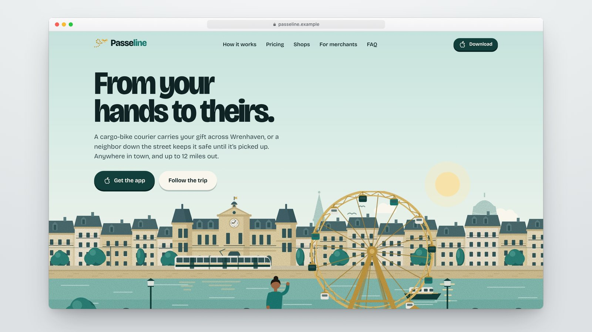

# Landing pages

A collection of landing pages and marketing sites. Each one is a standalone
project in its own folder, with its own art direction, stack and README, and a
live deployment.

## Projects

| Preview | Project | What it is | Stack |
| --- | --- | --- | --- |
| [](https://ficelle-lndev.vercel.app) | **[Ficelle](ficelle)**<br>[live site](https://ficelle-lndev.vercel.app) | Gift-delivery app, "gift parcel" direction: kraft paper, shipping labels, stamps and receipts | Next.js 16, Tailwind CSS v4, shadcn/ui |
| [](https://passeline-lndev.vercel.app) | **[Passeline](passeline)**<br>[live site](https://passeline-lndev.vercel.app) | Gift-delivery app, illustrated direction: hand-drawn SVG town, from morning to night | Next.js 16, Tailwind CSS v4, shadcn/ui |
| [](https://aparte-lndev.vercel.app) | **[Aparté](aparte)**<br>[live site](https://aparte-lndev.vercel.app) | Gift-delivery app, editorial direction: magazine layout, Bodoni, photos | Next.js 16, Tailwind CSS v4, shadcn/ui |
| [](https://ecrin-lndev.vercel.app) | **[Écrin](ecrin)**<br>[live site](https://ecrin-lndev.vercel.app) | Gift-delivery app, immersive direction: dark, CSS 3D gift box, springy motion | Next.js 16, Tailwind CSS v4, shadcn/ui, Motion |

Click a preview to open the live site.

### About the gift-delivery series

Ficelle, Passeline, Aparté and Écrin answer the same brief: four art directions
for fictional gift-delivery apps set in made-up US towns. They share a color
palette (teal, deep teal, gold, ink and cream) and the same set of pages:

- home;
- a merchant page with a 5-step application form;
- a searchable FAQ;
- six sample legal pages;
- app link fallbacks and a 404.

Everything in them is invented: brands, places, people, prices and legal
texts. External links point to [lndev.me](http://lndev.me/). Each project's
README covers its product rules, art direction and files.

## Repository layout

```
landing-pages/
├── <project>/    one standalone project per landing page (own package.json and README)
├── www/          the showcase site presenting the collection (static HTML, CSS, JS)
│   ├── projects.js   the list of projects shown on the site
│   ├── showcase/     one preview image (.jpg) per project
│   └── media/        logos and favicon
├── LICENSE
└── README.md
```

Projects share nothing at the root: each folder installs, builds and deploys
on its own, with whatever stack it needs.

## Run a project

Each project's README lists its requirements, commands and environment
variables. For the current projects (Next.js, pnpm, Node 20+):

```bash
cd ficelle        # or any project folder
pnpm install
pnpm dev
```

## Deploy

Deploy each folder as its own site. On Vercel, import this repository once per
project and set **Root Directory** to the project's folder.

## Add a landing page

1. Create a folder named after the project (lowercase, no spaces, for example
   `my-product/`). It must be self-contained, with its own dependencies, its
   own lockfile and its own `.gitignore`.
2. Write its `README.md`: what it is, art direction, stack, how to run it,
   environment variables, and anything fictional or placeholder.
3. Deploy it (for example on Vercel, with the project's folder as **Root
   Directory**) and add its preview image to `www/showcase/`:
   `my-product.jpg`, 16:9, about 1600 px wide.
4. Add a row to the **Projects** table above, with the preview linking to the
   live site.
5. Add an entry to `www/projects.js` (and, optionally, its logo to
   `www/media/`). The showcase site's cards, index and counts follow.

## Showcase site

`www/` is a static site that presents the collection: no build step, no
dependencies. Preview it locally with:

```bash
cd www && python3 -m http.server
```

To deploy it on Vercel, import the repository once more with **Root
Directory** set to `www`.

## Showcase videos

Showcase videos are not versioned and the showcase site does not use them.
Keep them next to the preview images in `www/showcase/` (for example
`www/showcase/my-product.mp4`, or `www/showcase/2k/` for higher-resolution
masters): git and Vercel ignore every `.mp4` in that folder.

## License

The code is released under the [MIT License](LICENSE).

The MIT License does not cover:

- **Fonts**: bundled fonts keep their own licenses, mostly the SIL Open Font
  License. The license text sits next to the font files, in each project's
  `app/fonts/` folder.
- **Third-party images used as placeholders**: in the current projects, these
  are the JPEG photos in `public/images/`.
