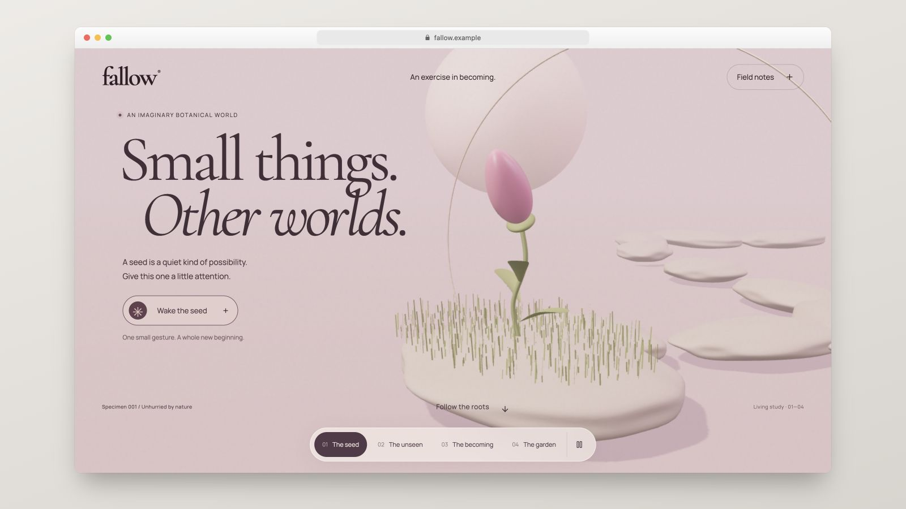
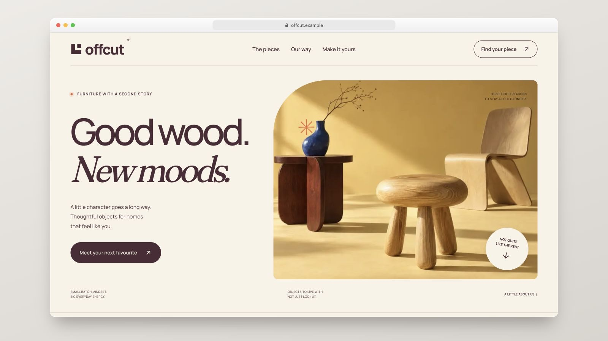
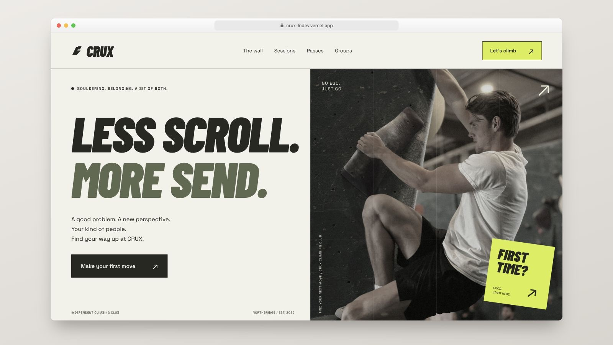
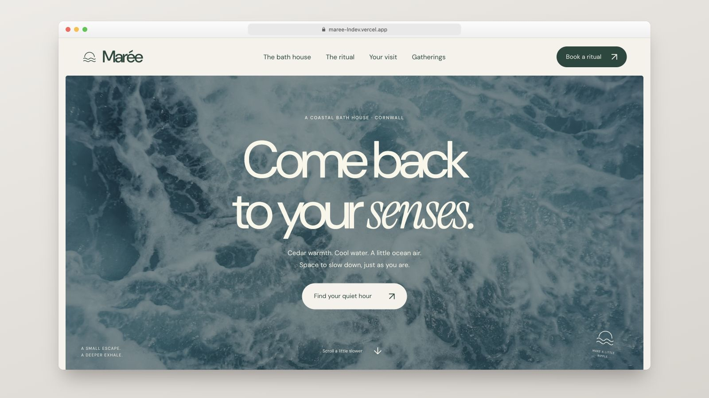

# Landing pages

Eight standalone landing pages and marketing sites built with Next.js, Tailwind
CSS and fully customized shadcn/ui components. Each project has its own visual
identity, typography, voice, animations and interactions, and can be installed,
built and deployed independently.

Browse the collection at **[lp.lndev.me](https://lp.lndev.me)**.

## Projects

| Preview | Project | What it is | Stack |
| --- | --- | --- | --- |
| [](https://fallow-lndev.vercel.app) | **[Fallow](landing-pages/fallow)**<br>[live site](https://fallow-lndev.vercel.app) | An imaginary botanical world: four connected WebGL chapters, a seed that wakes and blooms, species selection and an illustrated specimen to keep | Next.js 16, Tailwind CSS 4, shadcn/ui, Three.js |
| [](https://offcut-lndev.vercel.app) | **[Offcut](landing-pages/offcut)**<br>[live site](https://offcut-lndev.vercel.app) | Furniture atelier: butter yellow, plum, original wooden objects in Three.js, collection filters, a finish configurator and a local project brief | Next.js 16, Tailwind CSS 4, shadcn/ui, Three.js |
| [](https://crux-lndev.vercel.app) | **[Crux](landing-pages/crux)**<br>[live site](https://crux-lndev.vercel.app) | Independent bouldering club: condensed italic typography, acid lime, chalk, an interactive circuit board and filterable sessions | Next.js 16, Tailwind CSS 4, shadcn/ui |
| [](https://maree-lndev.vercel.app) | **[Marée](landing-pages/maree)**<br>[live site](https://maree-lndev.vercel.app) | Coastal bath house: sea green, linen, ocean photography, warm/cool/rest exploration and an optional breathing pause | Next.js 16, Tailwind CSS 4, shadcn/ui |
| [](https://passeline-lndev.vercel.app) | **[Passeline](landing-pages/passeline)**<br>[live site](https://passeline-lndev.vercel.app) | Gift-delivery app, illustrated direction: a hand-drawn SVG town that changes from morning to night | Next.js 16, Tailwind CSS 4, shadcn/ui |
| [](https://ficelle-lndev.vercel.app) | **[Ficelle](landing-pages/ficelle)**<br>[live site](https://ficelle-lndev.vercel.app) | Gift-delivery app, parcel direction: kraft paper, shipping labels, stamps and receipts | Next.js 16, Tailwind CSS 4, shadcn/ui |
| [](https://aparte-lndev.vercel.app) | **[Aparté](landing-pages/aparte)**<br>[live site](https://aparte-lndev.vercel.app) | Gift-delivery app, editorial direction: magazine layout, Bodoni and photography | Next.js 16, Tailwind CSS 4, shadcn/ui |
| [](https://ecrin-lndev.vercel.app) | **[Écrin](landing-pages/ecrin)**<br>[live site](https://ecrin-lndev.vercel.app) | Gift-delivery app, immersive direction: a dark setting, a CSS 3D gift box and springy motion | Next.js 16, Tailwind CSS 4, shadcn/ui, Motion |

Every preview links to its live demo at `https://[name]-lndev.vercel.app`,
using the lowercase, unaccented folder name (for example,
[fallow-lndev.vercel.app](https://fallow-lndev.vercel.app)). Project names link
to their source folders.

### One foundation, eight identities

These are fully customized shadcn/ui projects. Shared primitives provide the
accessible controls; the layout, visual language and motion belong to each
project. The collection explores a consistent product brief through four
gift-delivery brands, then extends to climbing, coastal wellness, furniture
design and interactive botanical storytelling.

### Fallow and Offcut

Fallow is a full-screen, continuous 3D story. Native scrolling changes the
camera, lighting and composition of one original procedural garden across four
chapters. Wake its seed, explore its roots, select an imagined species and keep
a generated SVG botanical specimen. The HTML story remains usable without
WebGL; mobile rendering is limited and ambient animation can be paused.

Offcut is a furniture atelier with smooth, original Three.js models: bevelled
edges, turned profiles, procedural wood grain, satin materials and studio
lighting. Scroll and pointer movement subtly change perspective. Collection
filters and a live finish configurator lead into a local project brief. Models
load near the viewport, rendering stops when settled, and an SVG fallback is
available without WebGL.

Both projects use custom shadcn controls, local fonts, responsive layouts,
reduced-motion support and clearly identified fictional products.

### Crux and Marée

Crux and Marée use the `base-maia` shadcn foundation, built on Base UI, with
fully customized components, fonts, motion and art direction. Each has a full
homepage, a three-step sample visit planner, a group enquiry page, a searchable
FAQ, information pages and a custom 404. Forms are interactive local
demonstrations; they do not make real reservations or send data.

Calendar and popover date pickers, grouped form fields, textareas, tabs,
accordions and mobile navigation all use customized shadcn/ui components.
Their scrolling bands loop continuously, include a pause control and become
static when reduced motion is requested. Desktop navigation is centered;
mobile menus and controls have comfortable touch targets. Photos and fonts
are bundled locally, with credits and licenses in each project.

### About the gift-delivery series

Passeline, Ficelle, Aparté and Écrin answer the same brief: four art directions
for fictional gift-delivery apps set in made-up US towns. They share a color
palette (teal, deep teal, gold, ink and cream) and the same set of pages:

- home;
- a merchant page with a 5-step application form;
- a searchable FAQ;
- six sample legal pages;
- app link fallbacks and a 404.

Everything in them is invented: brands, places, people, prices and legal
texts. External links (app stores, partner portals, QR codes) lead to each
project's own source folder on GitHub. Each project's README covers its
product rules, art direction and files.

## Repository layout

```text
landing-pages/
├── landing-pages/    standalone landing-page projects
│   ├── aparte/
│   ├── crux/
│   ├── ecrin/
│   ├── fallow/
│   ├── ficelle/
│   ├── maree/
│   ├── offcut/
│   └── passeline/
├── www/              the collection showcase: static HTML, CSS and JS
│   ├── projects.js   project records used by the gallery and index
│   ├── showcase/     framed 1600 × 900 preview images (.jpg)
│   ├── analytics.js  Vercel Web Analytics for the static site
│   └── media/        logos, favicon and locally bundled fonts
├── .github/FUNDING.yml
├── LICENSE
└── README.md
```

Each project in `landing-pages/` has its own `package.json`, lockfile and
README. Projects share no build configuration at the repository root: each
installs, builds and deploys independently.

## Run a project

Each project's README lists its requirements, commands and environment
variables. From the repository root, use pnpm and Node 20.9 or newer:

```bash
cd landing-pages/fallow        # or another folder in landing-pages/
pnpm install
pnpm dev
```

## Deploy

Deploy each project as its own site. On Vercel, import this repository once
per project and set **Root Directory** to `landing-pages/[name]` (for example,
`landing-pages/fallow` or `landing-pages/crux`). Use the Next.js preset for
all eight landing pages. The buildless showcase uses the Other preset and
**Root Directory** `www`.

For an existing Vercel project created before this folder layout, change its
**Root Directory** from `[name]` to `landing-pages/[name]` before deploying
this revision. The public domains do not change.

For Crux, Marée, Offcut and Fallow, set `NEXT_PUBLIC_SITE_URL` to the actual
public origin for sitemap and absolute metadata URLs; see each project's
`.env.example`. Live previews use `https://[name]-lndev.vercel.app`, with
the lowercase, unaccented project folder name. Use that origin in the
showcase and project metadata.

## Add a landing page

1. Create a folder named after the project (lowercase, no spaces, for example
   `landing-pages/my-product/`). It must be self-contained, with its own
   dependencies, lockfile and `.gitignore`.
2. Write its `README.md`: what it is, art direction, stack, how to run it,
   environment variables, and anything fictional or placeholder.
3. Add a real homepage capture to `www/showcase/my-product.jpg`, 1600 × 900.
   Match the collection's rounded browser window, neutral background and
   soft shadow.
4. Add a row to the **Projects** table above. Link the preview to
   `https://my-product-lndev.vercel.app` and the project name to its source folder.
5. Add a record to `www/projects.js`, using an existing entry as the schema.
   Choose its `group` (`immersive`, `editorial` or `playful`), and provide its
   copy, typography, palette, stack and image. Use a title-case display name
   and set `url` to `https://my-product-lndev.vercel.app`. Set `source` only
   when overriding the default GitHub folder, `landing-pages/[slug]`.
6. Update the static JSON-LD list, `<noscript>` fallback, visible counts and
   filter counts in `www/index.html`. Add the preview to `www/sitemap.xml`.
   These are maintained separately from the JavaScript data.
7. Deploy the project with `landing-pages/my-product` as **Root Directory**
   and the Vercel project name `my-product-lndev`. Keep its links consistent
   in this README, the JSON-LD and the `<noscript>` fallback. The hero automatically
   includes every entry from `www/projects.js`; its three static cards are the
   fallback shown before JavaScript loads.

## Showcase site

`www/` presents all eight projects in a filterable gallery with an alternative
index view. The hero rotates through the entire collection every five seconds,
keeping only three cards on screen: one in front and two in the stack. It
prepares the next preview image and recycles the outgoing card while invisible
for a smooth transition. Rotation pauses on hover, keyboard focus,
while offscreen or in a hidden tab, and when animations are paused or reduced
motion is requested. Each project includes source links and a **Behind the
design** panel. The site uses
local typography, light and dark themes, an infinite ticker, scroll reveals
and a motion control that respects the system's reduced-motion preference.
The theme preference is stored in the browser. A static project list remains
available when JavaScript is disabled.

The showcase has no build step or dependencies. Preview it locally with:

```bash
cd www
python3 -m http.server
```

It is hosted at [lp.lndev.me](https://lp.lndev.me). To deploy it on Vercel,
import the repository once more with **Root Directory** set to `www`.

Vercel Web Analytics is initialized by `www/analytics.js` on the homepage
and 404 page using the plain HTML tracking script. Enable **Web Analytics**
in the Vercel project dashboard and redeploy `www/`; Vercel then serves
`/_vercel/insights/script.js`. Localhost and file previews skip the tracking
script. No React component, npm package or build step is required for this
static integration. See the [Vercel quickstart](https://vercel.com/docs/analytics/quickstart).

The public URL, `https://lp.lndev.me`, is written in `www/index.html`
(canonical, Open Graph and structured data), `www/robots.txt` and
`www/sitemap.xml`: update all three if it changes. Project records are in
`www/projects.js`; static metadata, fallback links and sitemap images must
also be kept in sync when projects are added, removed or deployed.

## Showcase videos

Showcase videos are not versioned and the showcase site does not use them.
Keep them next to the preview images in `www/showcase/` (for example
`www/showcase/my-product.mp4`, or `www/showcase/2k/` for higher-resolution
masters): git and Vercel ignore every `.mp4` in that folder.

## Support the project

Developed by **[LN](https://lndev.me)**. The [source code](https://github.com/ln-dev7/landing-pages)
is free to read, fork and reuse under MIT. If you would like to support this
collection and my other open-source work, you can
[make a contribution](https://lndev.mychariow.shop/prd_3cu1s0).
The same link is available through GitHub's Sponsor button, configured in
`.github/FUNDING.yml`, the showcase header and the project footers.

## License

The code is released under the [MIT License](LICENSE).

The MIT License does not cover:

- **Fonts**: bundled fonts keep their own licenses, mostly the SIL Open Font
  License. License texts sit next to the fonts in each project's `app/fonts/`
  folder and in `www/media/fonts/`.
- **Third-party images used as placeholders**: see each project's asset
  credits for the source and applicable terms. Original illustrations,
  procedural models and generated imagery are documented in project READMEs.
