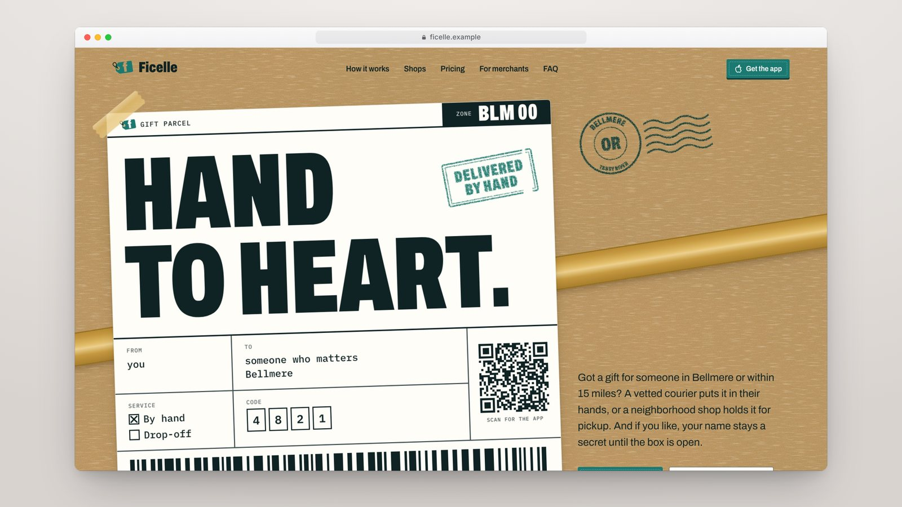
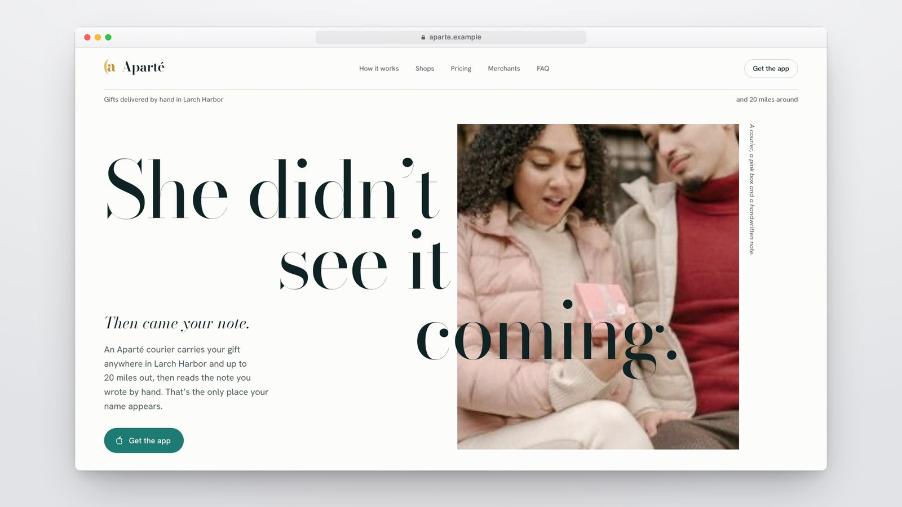
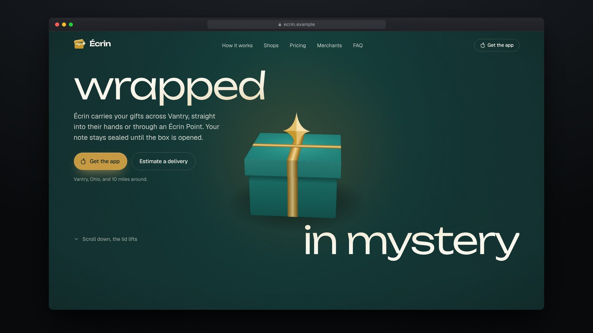

# Landing pages

Four complete marketing sites for four **fictional** gift-delivery apps. They
share one brief and take four different art directions. Each site is a
standalone Next.js project in its own folder, with its home page, merchant
page, application form, FAQ, legal pages and share image, all written in
American English.

| | |
|:-:|:-:|
| [](showcase/ficelle.mp4)<br>**[Ficelle](ficelle)** · gift parcel · [video](showcase/ficelle.mp4) | [](showcase/passeline.mp4)<br>**[Passeline](passeline)** · illustrated · [video](showcase/passeline.mp4) |
| [](showcase/aparte.mp4)<br>**[Aparté](aparte)** · photo and emotion · [video](showcase/aparte.mp4) | [](showcase/ecrin.mp4)<br>**[Écrin](ecrin)** · immersive and animated · [video](showcase/ecrin.mp4) |

Click a preview to watch its showcase video (1920×1080, 60 fps, about 40 s).

## The brief

Each site sells the same kind of product: an app that gets a gift across one
town, either handed over in person by a vetted courier or held nearby until the
recipient picks it up. It also recruits couriers, the people or shops who hold
parcels, and local merchants.

The four sites share these constraints:

- **Palette**: teal `#1A7971`, deep teal `#123F3B`, gold `#C59940`, light gold
  `#E3BE6B`, ink `#0F2324`, cream `#F9F6ED`.
- **Fonts and layout**: free for each direction.
- **Components**: shadcn/ui (Base UI), restyled to match each direction.

Everything is invented: brands, towns, founders, shops, companies, prices,
rules and legal texts.

## The four directions

### [Ficelle](ficelle): gift parcel

The page looks like a parcel being packed:

- kraft paper with drawn fibers, shipping labels, teal ink stamps, receipts and
  tape;
- the hero is a shipping label;
- the delivery picker prints a live receipt;
- on the merchant page, the application form is a shipping slip.

**Type:** Archivo, extra condensed, plus IBM Plex Mono.
**Motion:** the code types itself in and a scanner beam sweeps the barcode,
stamps thunk down as you scroll, shipping tags swing on hover, and the receipt
reprints when the price changes.
**Setting:** Bellmere, Oregon.

### [Passeline](passeline): illustrated

One gift crosses town in hand-drawn SVG scenes:

- a gold dotted route links the scenes, and the gift follows it as you scroll;
- the page moves from morning to night;
- the merchant page lights up a shop window.

**Type:** Bricolage Grotesque.
**Motion:** the streetcar rolls in, the Ferris wheel turns, the route draws
itself and the town lights up in waves at night.
**Setting:** Wrenhaven, Vermont.

### [Aparté](aparte): photo and emotion

An editorial magazine:

- a Bodoni cover, running heads with page numbers, a drop cap and a pull quote;
- an address book with dotted leaders;
- the merchant page is a "special issue" with an application form;
- a shop front and a gift card are drawn in code.

**Type:** Bodoni Moda plus Hanken Grotesk.
**Motion:** slow and quiet. Rules unroll, quotes appear like ink, the
storefront globes flicker on, and the gift card slides out of its envelope.
**Setting:** Larch Harbor, Washington.

### [Écrin](ecrin): immersive and animated

A dark launch site:

- a CSS 3D gift box that opens as you scroll and releases the three promises;
- an interactive price demo;
- on the merchant page, the box becomes a display case.

**Type:** Unbounded plus Geist.
**Motion:** springy and fluid, built with Motion for React. The box leans
toward the cursor, buttons are magnetic, totals roll and a light follows the
cursor.
**Setting:** Vantry, Ohio.

## What every site includes

| Route | Content |
| --- | --- |
| `/` | Home: how it works, the two delivery modes with a price estimate, shops, couriers, FAQ |
| `/for-merchants` | Merchant landing page and a 5-step application form (`#form`) |
| `/faq` | Searchable FAQ with a deep link to each question |
| `/terms`, `/privacy`, `/legal`, `/delete-account`, `/courier-agreement`, `/merchant-agreement` | Sample legal documents |
| `/shop`, `/product`, `/chip-in/…`, `/join/…` | Fallback pages for the app's universal links |
| any other path | 404 page |

Each site also ships:

- `sitemap.xml` and `robots.txt`;
- `/.well-known/apple-app-site-association`;
- a generated share image (`app/opengraph-image.png`);
- Organization JSON-LD.

The merchant form has these features:

- per-step validation with zod;
- a US state combobox, plus ZIP and optional EIN checks;
- photo upload with preview and compression;
- a Server Action that posts the application to `PARTNER_WEBHOOK_URL`.

Every site respects `prefers-reduced-motion`, has visible keyboard focus and
uses local fonts. They are responsive from 360 px to wide screens with no
horizontal scroll.

## Stack

- Next.js 16 (App Router, Turbopack) and React 19.
- Tailwind CSS v4.
- shadcn/ui on Base UI, every component restyled per direction.
- Hugeicons and zod.
- Motion for React, in Écrin only. The other three animate with CSS and the
  Web Animations API.

## Structure

```
landing-pages/
├── ficelle/      Next.js project, gift parcel
├── passeline/    Next.js project, illustrated
├── aparte/       Next.js project, photo and emotion
├── ecrin/        Next.js project, immersive and animated
└── showcase/     showcase videos (.mp4) and their posters (.jpg)
```

Each project has its own `README.md`, which covers the product rules, art
direction, files and checks.

## Run a site

Requires Node 20+ and pnpm.

```bash
cd ficelle          # or passeline, aparte, ecrin
pnpm install
pnpm dev            # http://localhost:3000
```

Checks: `pnpm exec tsc --noEmit`, `pnpm exec eslint app components lib`,
`pnpm build`.

### Environment

| Variable | Use |
| --- | --- |
| `PARTNER_WEBHOOK_URL` | Optional. The merchant form posts each application there (`multipart/form-data`, fields and photo); without it, applications are only logged on the server. |

### Deploy

Each folder deploys on its own. On Vercel, import the repository once per site
and set **Root Directory** to `ficelle`, `passeline`, `aparte` or `ecrin`.

## Showcase videos

The `showcase/` folder holds one MP4 per site (H.264, 1920×1080, 60 fps) and a
poster image. Each video was filmed from the production build with a
deterministic headless Chrome capture:

- the page sits in a framed browser window;
- the scroll pace adapts to the content;
- a cursor hovers the interactive elements and makes safe clicks (delivery
  mode, distance slider, FAQ);
- the camera zooms gently onto the element in use.

## Notes

- **External links**: every link that leaves a site (App Store buttons, QR
  codes, merchant portal, driver app) points to [lndev.me](http://lndev.me/).
  These links are set in each project's `lib/site.ts`.
- **Placeholders**: domains end in `.example`, phone numbers use the fictional
  555-01xx range and ZIP codes are `00000`.
- **Legal texts**: these are samples, written to fill the layout. Have a lawyer
  review them before any real use.
- **Photos**: some sites use a few stock-style photos as placeholders. Replace
  them with licensed images before shipping.
